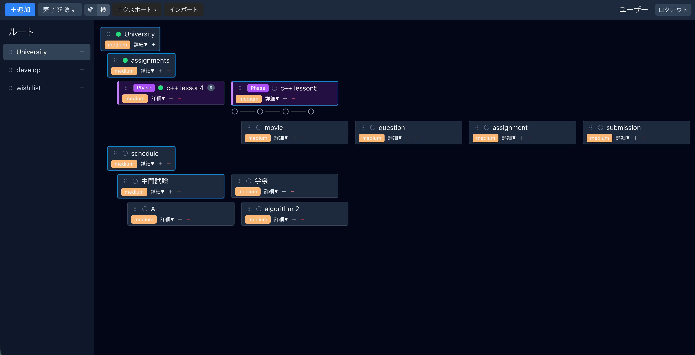

# rami

**ツリー × ステップの 2 軸でタスクを管理する、セルフホスト型 ToDo アプリ。**
MCP(Model Context Protocol)サーバーを内蔵しているので、Claude などの AI クライアントから直接ツリーを操作できる。

> **開発中のプロジェクトです。** 自分用に作っているものを公開しています。
> 機能・スキーマは今後も変わる可能性があります。未実装の制約は「現在の制約」に記載しています。

> **このリポジトリはアプリ本体のソースコードです。** 公式のホスティングサービスは提供していないため、
> 使うには自分の環境で動かす(セルフホストする)必要があります。



*`Phase` ノード(紫)の下にステップが並び、プログレスラインで進捗が見える。左のサイドバーはルートノードの一覧。*

---

## 特徴

### ツリーとステップの 2 軸モデル

ノードは `task` と `phase` の 2 種類を持つ。

- **`task` の子** … 自由な並び順(ドラッグで入れ替え可能)
- **`phase` の子** … **ステップ番号(Step 1, 2, 3...)** が自動で振られ、順番に進める対象になる

`task` と `phase` はいつでも切り替えられ、切り替えると**子の並び順とステップ番号が相互に変換される**。「ざっくりしたタスクの入れ物」と「手順が決まった工程」を、同じツリーの中で行き来しながら管理できる。

### ステップの順序ルール

`phase` の配下では「手前が終わっていないと次に進めない」という制約がかかる。ただし **Shift + クリック**(デスクトップ)と**長押し**(モバイル)で強制的に飛ばせる。実際の作業は順番どおりに進まないので、制約と逃げ道の両方を用意している。

### AI クライアントから操作できる

MCP サーバーを内蔵している。AI クライアントに接続すると、チャットから次のようなことができる。

```
「ツリーを見せて」
「Python 学習プログラムを 3 フェーズで作って」
「Step 1 を完了にして」
「進捗は？」
```

ツールは 12 種類(ツリー取得・ノード CRUD・移動・複製・種類切り替え・ステップ一括追加・並び替え・進捗集計・条件検索)。

### その他

- JSON / CSV でのエクスポート、JSON のインポート
- ドラッグ & ドロップでの並び替え・階層移動(循環参照は防止される)
- 完了したノードの非表示トグル、縦横の表示切り替え
- 親の状態は子から自動計算される(子が全部完了したら親も完了)

---

## 技術スタック

| 層 | 使用技術 |
|---|---|
| バックエンド | Node.js / Fastify / Prisma / PostgreSQL 18 |
| フロントエンド | React 19 / Vite / TypeScript / Tailwind CSS / dnd-kit |
| 認証 | JWT(access 15 分 + refresh 7 日・httpOnly Cookie) |
| AI 連携 | Model Context Protocol(stdio / Streamable HTTP) |
| インフラ | Docker Compose |

---

## 動かす

### 必要なもの

- Docker / Docker Compose

### 1. 環境変数を用意する

`.env.example` をコピーして `.env` を作る。

```bash
cp .env.example .env
```

| 変数 | 説明 |
|---|---|
| `POSTGRES_USER` / `POSTGRES_PASSWORD` / `POSTGRES_DB` | DB の接続情報 |
| `DOMAIN` | 本番構成で使う公開ドメイン |
| `SENTRY_DSN` / `VITE_SENTRY_DSN` | エラートラッキング(任意。未設定なら無効) |
| `MCP_TRANSPORT` | `stdio`(開発) / `http`(MCP を HTTP で公開する場合) |

加えて `server/.env` に以下を置く。

```bash:server/.env
DATABASE_URL=postgres://<user>:<password>@db:5432/<dbname>
JWT_SECRET=<32文字以上のランダム文字列>
PORT=3001
```

> `JWT_SECRET` は**開発用のみ**。本番構成(`compose.prod.yml`)では `entrypoint.sh` が自動生成して volume に永続化するため、指定する必要はない。

### 2. 起動する

```bash
docker compose up -d
```

- フロントエンド … http://localhost:3002
- API … http://localhost:3001

### 3. マイグレーションを当てる

開発用の構成では自動では走らないので、初回は手動で実行する。

```bash
docker compose exec -it server npx prisma migrate deploy
```

ブラウザから `http://localhost:3002` を開き、ユーザー登録すれば使い始められる。

### 本番相当の構成

`compose.prod.yml` を使うと、マルチステージビルドしたイメージ・Nginx での静的配信・`JWT_SECRET` の自動生成・日次 DB バックアップが有効になる。

```bash
docker compose -f compose.prod.yml up -d --build
```

マイグレーションは起動時に自動で適用される。

---

## MCP サーバーを繋ぐ

**接続先は、自分で立てた rami のインスタンス**になる。共有のサーバーに繋ぐ形ではないので、先に上記の手順で起動しておく必要がある。

接続方式は 2 つある。

### ローカルで使う(stdio)

AI クライアントの設定ファイルに登録する。Claude Desktop の場合:

```json:claude_desktop_config.json
{
  "mcpServers": {
    "rami": {
      "command": "/absolute/path/to/node",
      "args": ["/absolute/path/to/rami/server/dist/mcp/index.js"],
      "env": {
        "DATABASE_URL": "postgres://<user>:<password>@localhost:5432/<dbname>",
        "RAMI_USER_ID": "<操作対象ユーザーの UUID>",
        "JWT_SECRET": "dummy",
        "PORT": "3001"
      }
    }
  }
}
```

- 事前に `npm run build`(server ディレクトリ)が必要
- `RAMI_USER_ID` は stdio モード専用。**stdio は単一ユーザー・開発用**として扱っている
- `JWT_SECRET` / `PORT` は MCP では使わないが、設定の検証を通すために必要

### リモートで使う(Streamable HTTP)

`MCP_TRANSPORT=http` にすると、API サーバーと同じプロセスで `/mcp` が有効になる。AI クライアントには URL とトークンを登録する。

```
URL    : https://<自分のインスタンスのドメイン>/mcp
Header : Authorization: Bearer <発行したトークン>
```

トークンは SHA-256 のハッシュで保存され、発行時に一度だけ平文が表示される。失効・有効期限にも対応している。

リバースプロキシを挟む場合の注意:

- **転送先にパスを書かない**(リクエストのパスはそのまま転送される)
- レスポンスは `text/event-stream` なので、**バッファリングするプロキシでは応答が届かない**
- 公開するのは **`/mcp` のパスだけ**にすることを推奨(理由は下記)

---

## 現在の制約

| 項目 | 状況 |
|---|---|
| **トークン発行の UI** | 未実装。現状はコンテナ内でスクリプトを実行して発行する |
| **サインアップの制御** | 未実装。**アプリ全体を外部公開すると、誰でもアカウントを作成できる** |
| ステップの順序ルール | MCP 経由では適用されない(意図的な設計。AI には制約を課していない) |
| MCP の認証 | 静的なベアラトークンのみ。OAuth には未対応 |

**インターネットに公開する場合は、`/mcp` のパスのみを公開することを強く推奨する。** サインアップ制御が入るまでは、アプリ本体は LAN や VPN の内側に置く想定で作られている。

---

## ライセンス

[MIT](./LICENSE)
